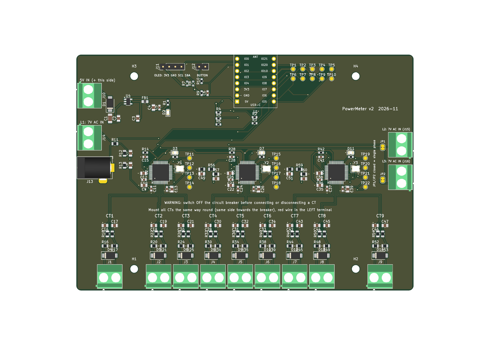

# PowerMeter

ESP32-C3 project for measuring the power consumed per circuit breaker in your home.



PowerMeter measures the **real power and energy of each circuit (group) in a household fuse box**. A small current transformer clamps around the live wire of every circuit. Three dedicated energy-metering ICs sample all currents and the mains voltage **simultaneously**. An ESP32-C3 serves the results on a web page over Wi-Fi.

## Features

- **7 circuits + 2 spare channels** in a single-phase home, or **up to 3 circuits per phase (9 in total) in a three-phase home**. Each metering chip has its own voltage input; two solder jumpers (closed by default) link them for single-phase use.
- **True real power with sign**, so a circuit with a solar inverter shows production as negative power. Import and export energy are counted separately.
- **Energy-metering ICs do the maths.** Three Microchip **ATM90E32AS** sample every channel at 8 kHz and compute active/reactive power, RMS voltage/current, power factor and energy in hardware.
- **Web page on the ESP32-C3** (no Home Assistant required), plus an optional **128×64 OLED** and a **push button** for a local readout and Wi-Fi setup.
- **SELV only on the board.** No mains voltage reaches the PCB: the voltage reference comes from a 7 V AC plug-in adapter, power from a 5 V USB charger.
- **Designed for JLCPCB assembly.** All SMD parts are placed by JLCPCB; only the screw terminals and headers are hand-soldered.

## How it works

```
 CT (2000:1) ─► burden 2×22 Ω ─► RC 1k/33nF ─┐
 CT ... (9×)                                  ├─► 3× ATM90E32AS ──SPI──► ESP32-C3 SuperMini ──Wi-Fi──► web page
 7 V AC adapter ─► divider 22k/1k ─► RC ─────┘          ▲                        │
                                                 clean 3.3 V (LDO)        OLED (I²C) + button
 5 V USB ─► SS14 ─► SuperMini 5V pin + AP2112K-3.3 ─┘
```

| Item | Value |
|---|---|
| Current sensors | DL-CT08CL5, 2000:1 (20 A / 10 mA), solid-core |
| Measuring range per channel | ~5.5 mA … 32 A RMS (≈1.3 W … 7.5 kW at 230 V) |
| Burden / anti-aliasing | 2 × 22 Ω centre-tapped to GND, 1 kΩ + 33 nF C0G per input |
| Voltage sensing | One 7 V AC input per metering chip (L1 = CT1–3, L2 = CT4–6, L3 = CT7–9), each with a 22 kΩ / 1 kΩ divider phase-matched to the current inputs. JP1/JP2 closed = one adapter for all three |
| Metering ICs | 3 × ATM90E32AS (3 current + 3 voltage ADCs each, 16.384 MHz crystal) |
| Controller | ESP32-C3 SuperMini, plugged into female headers |
| Power | 5 V via a screw terminal (cut-off USB cable) |
| PCB | 140 × 98 mm, 2 layers, fits a Kradex Z74 (176 × 126 × 57 mm) enclosure |

### ESP32-C3 pin assignment

| Function | GPIO |
|---|---|
| SPI SCLK / MISO / MOSI | 4 / 5 / 6 |
| Chip select ATM 1 / 2 / 3 | 7 / 10 / 3 |
| OLED I²C SDA / SCL | 20 / 21 |
| Push button | 1 |
| Spare (test pad) | 0 |

## Repository contents

| Path | Contents |
|---|---|
| `Hardware/PowerMeter.kicad_pro` | KiCad 10 project: schematic (ERC clean) and routed PCB (DRC: 0 errors, 0 unconnected) |
| `Hardware/PowerMeter.kicad_sym`, `Hardware/PowerMeter.pretty/` | Project libraries: ATM90E32AS symbol, ESP32-C3 SuperMini symbol and socket footprint |
| `Hardware/PowerMeter_v2_schema.pdf` | Schematic as PDF |
| `Hardware/PowerMeter_v2_BOM.csv` | Full bill of materials with LCSC part numbers |
| `Hardware/Productie/` | JLCPCB order package: Gerber zip, assembly BOM and CPL, and ordering notes |
| `Hardware/Ontwerp_v2_ESP32-C3.md` | Full design document: calculations, layout rules, bring-up plan, ESPHome config (in Dutch) |
| `Hardware/CAMOutputs/` | Gerbers of the earlier v1 board (Raspberry Pi + ADS1115), kept for reference |

## Building one

1. **Order the PCB.** Upload `Hardware/Productie/PowerMeter_v2_Gerbers.zip`, `JLCPCB_BOM.csv` and `JLCPCB_CPL.csv` to JLCPCB (2 layers, 1.6 mm, top-side assembly).
   - Check part rotations in the placement preview, especially the three ATM90E32AS (pin 1 bottom-left) and the SOT-23-5 regulator.
   - See `Hardware/Productie/LEESMIJ_bestellen.md` for all settings.
2. **Hand-solder the through-hole parts:** 13 screw terminals (5.08 mm), the DC jack, 2 × 8-pin female headers for the SuperMini, and the OLED and button headers.
3. **Bring it up step by step:**
   - With only 5 V applied: check 3.3 V, and per chip VDD18 ≈ 1.8 V and Vref ≈ 1.2 V.
   - Then fit the SuperMini, connect the AC adapter and one CT.
   - Calibrate voltage and current against a multimeter and a known load (e.g. a kettle).
4. **Firmware.** Start with ESPHome. Its `atm90e32` component and `web_server` (version 3, with graphs) work without Home Assistant. A starting configuration is in the design document. Custom firmware with long-term history is planned.

## Safety

The PCB itself only carries safe low voltages, but **installing the CTs means working inside the fuse box**:

- **Switch off the main breaker.** The CTs are solid-core, so the wire of each circuit has to be disconnected to slide it through. Get a qualified electrician if you are unsure.
- **Measure only the live (L) wire** of each circuit.
- **Never connect or disconnect a CT while current flows through it.** The silkscreen warns about this, too.
- **Mount all CTs the same way round,** with the red wire in the left terminal. A reversed CT simply reads negative power.

## Status and background

- **Status:** design complete, PCB routed and ready to order (including the three-phase voltage inputs added on 10 November 2026); not yet built or tested.
- **v1:** an earlier attempt used a Raspberry Pi with ADS1115 ADCs and LM358 buffers. It never worked: two ADCs were on the same I²C address, the op-amps were not rail-to-rail, and the ADS1115 is too slow to sample voltage and current simultaneously.
- **Inspiration:** a friend's Arduino-based [energy logger](https://rands.nl/projects/logger.htm).

## License

[MIT](LICENSE)
